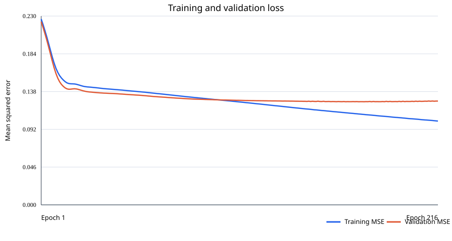

# Training the local color matcher

Grade Match can use a small supervised neural network trained locally with your examples. Training runs with Python and the exported model runs in the browser through ONNX Runtime Web. There is no remote inference API; the photos are not uploaded.

## What data is needed?

Each labeled example must have:

1. A source photo to edit.
2. A reference photo showing the look to match.
3. The desired Lightroom-style settings for editing the source photo.

Photos without desired setting labels are not enough to teach this model which edit to predict. You can create labels by editing a source photo in Lightroom, then recording the settings for the intended matched result. Use varied scenes and looks, and reserve some examples for testing rather than training.

Create a JSON Lines file with one object per line. Photo paths are relative to the manifest file:

```json
{"source":"images/source-001.jpg","reference":"images/reference-001.jpg","settings":{"temp":6,"tint":-3,"exposure":0.2,"contrast":12,"highlights":-20,"shadows":15,"whites":4,"blacks":-8,"vibrance":10,"saturation":-2,"curve":[0,28,61,128,194,228,255],"hsl":[{"h":0,"s":0,"l":0},{"h":-2,"s":8,"l":1},{"h":0,"s":0,"l":0},{"h":0,"s":0,"l":0},{"h":0,"s":0,"l":0},{"h":-5,"s":4,"l":0},{"h":0,"s":0,"l":0},{"h":0,"s":0,"l":0}],"grade":{"sh":{"hue":205,"sat":18},"mid":{"hue":30,"sat":7},"hi":{"hue":42,"sat":10}}}}
```

`hsl` entries are ordered Red, Orange, Yellow, Green, Aqua, Blue, Purple, Magenta. `curve` contains the output values for input points 0, 32, 64, 128, 192, 224, 255. The numeric limits match the settings controls in the app.

## Train and export

Use Python 3.12 or newer. From the project folder:

```powershell
py -3 -m venv .venv
.\.venv\Scripts\Activate.ps1
python -m pip install -r requirements-train.txt
python train_color_matcher.py --manifest dataset\train.jsonl
```

The trainer requires at least five labeled examples to run and keeps a validation split. Five is only a technical minimum, not enough to expect reliable color matching; use many varied examples and keep genuinely separate photos for evaluation. It prints validation metrics and exports `public/models/color_matcher.onnx`. These metrics are a smoke check, not a guarantee of perceptual quality.

### Compact synthetic training run

For a local training run without FiveK, the project can use TensorFlow's 218 MB Flower Photos example archive. Its 3,670 CC BY 2.0 flower photos cover five flower categories; this is a small, domain-limited image set, not a professional photo-grading collection. The script creates three examples per photo by applying known, locally generated settings to the source itself and using that edited copy as the reference. This makes the labels correspond to the visible source-to-reference change:

```powershell
python -m pip install -r requirements-train.txt
python prepare_synthetic_training.py
python train_color_matcher.py --manifest dataset\flower_match\train.jsonl --output public\models\color_matcher.onnx
```

The resulting manifest contains 11,010 source/reference pairs. It keeps training and validation source-photo groups separate, so a photo cannot leak between the two splits. The trainer checks that source-image groups do not cross the split. The script writes per-photo credits to `dataset\flower_match\ATTRIBUTION.txt` and extracts the full archive credit list to `dataset\flower_match\Flower_Photos_LICENSE.txt`; source images, generated pairs, and the model stay under the Git-ignored `dataset/` folder or the ignored model path.

**Important limitation:** the photos are flowers and their references are synthetic edits, not photographer-authored grades. The current distilled model uses outputs from the JavaScript solver as labels. It can imitate that algorithm but cannot learn preferences the teacher does not express; it may not generalize to portraits, landscapes, or arbitrary human style matching. Review the held-out metrics in `dataset\flower_match\training_report.json` before relying on or sharing the model. For stronger results, use properly licensed, varied photographs and human-authored settings.

### Distill the JavaScript solver

To train the neural network to imitate the existing JavaScript solver, collect teacher labels for a subset of the generated pairs:

1. Start Vite with `npm run dev`.
2. In a second terminal, start the local-only label collector: `.\.venv\Scripts\python.exe export_js_teacher_labels.py --limit 1000`.
3. Open the URL printed by the collector, adding `?trainingTeacher=1&collectTeacherLabels=1` after `Grade%20Match.html` (for example, `http://localhost:5173/Grade%20Match.html?trainingTeacher=1&collectTeacherLabels=1`). Leave the browser tab open while it processes batches.
4. When the page reports that collection is complete, stop the collector with Ctrl+C and train from its output:

```powershell
.\.venv\Scripts\python.exe train_color_matcher.py --manifest dataset\flower_match\js_teacher_manifest.jsonl --output public\models\color_matcher.onnx
```

The collector binds only to localhost. Its browser training mode uses the JavaScript calculation matcher to create targets; the resulting validation score measures imitation of that matcher on held-out flower photos. It does not show that the neural network is more perceptually accurate than the teacher or that it generalizes to other types of photographs. Use a larger `--limit` to collect more pairs, allowing several minutes for each thousand images.

### Training report and graph

The trainer reports the completed and best epoch, train and validation MSE, normalized MAE, and per-slider validation MAE against a zero-adjustment baseline in `dataset\flower_match\training_report.json`. It also saves the loss history to `dataset\flower_match\training_history.csv` and an SVG chart to `docs\training_curves.svg`. Regression does not have a meaningful classification accuracy percentage; lower MAE/MSE is better.

The same-photo synthetic examples are designed to teach recovery of known edits, and should behave more coherently than the previous unrelated-photo labels. This still does **not** guarantee it will match arbitrary reference-photo styles as well as the hand-designed JavaScript solver. The dataset is flower-only and edits are generated by this project, not human authored. Compare the model with the calculation-based matcher on real source/reference pairs before claiming real-world accuracy.

The solver-distilled model completed 216 epochs (best epoch 176) on 800 pairs and validated on 200 pairs from separate photos. Validation MSE was 0.12566 (training MSE 0.11008); mean normalized MAE across the 50 outputs was 0.21753, versus 0.33363 for predicting zero on every output. Per-slider validation MAE is in the app's slider units:

| Setting | Model MAE | Always-zero MAE |
|---|---:|---:|
| Temperature | 19.12 | 25.16 |
| Tint | 17.50 | 26.34 |
| Exposure | 0.50 | 0.71 |
| Contrast | 36.51 | 39.40 |
| Highlights | 46.64 | 47.88 |
| Shadows | 33.00 | 34.45 |
| Whites | 59.13 | 67.12 |
| Blacks | 31.56 | 31.31 |
| Vibrance | 31.84 | 30.86 |
| Saturation | 18.11 | 22.12 |

This measures prediction of synthetic edit labels on held-out flower photos, **not** perceptual similarity to human grading or equivalence to the JavaScript solver. The training/validation curve is included below and saved as [`training_curves.svg`](./training_curves.svg) for reports.



As a separate, single-pair browser sanity check, the AI reduced the app's distance-to-reference metric by 62% on one held-out synthetic example; the JavaScript calculation-based matcher reduced it by 96% on the same pair. The app now evaluates both candidates and selects the one that is closer according to this same metric. This is a hybrid quality safeguard: it does not mean the neural model matches the solver in every case. One example is not a general performance estimate.

## Run the app

For a single HTML file you can open directly, run:

```powershell
npm install
npm run build:single
Start-Process ".\dist\Grade Match.html"
```

The page, app code, styles and browser inference runtime are bundled into `dist\Grade Match.html`. If you train a model and want the app to load that model, run it through the local development server instead:

```powershell
npm run dev
```

Open the local URL printed by Vite. When the ONNX file exists, this mode runs the trained model in the browser. If it is missing, the app clearly says that the trained model is unavailable and uses the existing non-AI solver as a fallback. The generated ONNX file is ignored by git so the dataset/model can remain private.

## Model outline

The input is a pair of 101-value image summaries: luminance and OKLab quantiles, color-band measurements, and shadow/midtone/highlight measurements. A small multilayer perceptron predicts 50 normalized settings, including the tone curve, HSL, and color grading. Training is supervised: it learns from your desired edits rather than calling a hosted model.
